# Panigalli RH Consultoria – Banco de Dados de Consultoria de RH

**Aluna:** Kailaine Cristina Gomes Panigalli | **Curso:** DSM | **Disciplina:** Modelagem de Banco de Dados  
**Trabalho Final – 2º Bimestre**

Estrutura do repositório:

```
├── README.md
├── diagramas/
│   ├── modelo_conceitual_DER.png
│   ├── modelo_logico.png
│   └── modelo_logico.dbml          (código do modelo lógico para o dbdiagram.io)
├── sql/
│   ├── 01_criacao_tabelas.sql      (modelagem física)
│   ├── 02_insercao_dados.sql       (carga de dados)
│   ├── 03_crud.sql                 (INSERT, SELECT, UPDATE, DELETE)
│   └── 04_relatorios.sql           (10 relatórios)
└── prints/                         (capturas de tela do Supabase)
```

---

## 1. Cenário

A **Panigalli RH Consultoria** é uma consultoria de Recursos Humanos que faz recrutamento e seleção para outras empresas. Empresas de vários ramos (varejo, indústria, saúde, tecnologia etc.) contratam a consultoria quando precisam preencher vagas. A consultoria tem uma equipe de consultores de RH, e cada consultor fica responsável por conduzir o processo seletivo das vagas que recebe. Ao mesmo tempo, a consultoria mantém um banco de talentos com pessoas que procuram emprego.

**Problema:** hoje o controle é feito em planilhas separadas: uma para as empresas, outra para as vagas e outra com os currículos recebidos por e-mail. Isso causa currículos duplicados, candidatos chamados para a mesma vaga duas vezes, telefones desatualizados e nenhuma forma rápida de saber quantos candidatos cada vaga recebeu, quem foi aprovado ou qual consultor preencheu mais vagas.

**Solução:** um banco de dados único que registra as empresas clientes, os consultores, as vagas, os candidatos com seus currículos e telefones, e todas as candidaturas com status e nota da entrevista. Com isso, a consultoria consegue acompanhar cada processo seletivo do começo ao fim e gerar relatórios.

### Entidades e atributos

| Entidade | Atributos |
|---|---|
| **EMPRESA_CLIENTE** | <u>id_empresa</u>, razao_social, cnpj, ramo_atividade, email_contato, data_cadastro, endereco (logradouro, numero, bairro, cidade, uf, cep) |
| **CONSULTOR** | <u>id_consultor</u>, nome, cpf, email, especialidade, salario, data_contratacao |
| **VAGA** | <u>id_vaga</u>, titulo, area, salario, modalidade, data_abertura, status, *total_candidatos* |
| **CANDIDATO** | <u>id_candidato</u>, nome, cpf, email, data_nascimento, *idade*, {telefone}, endereco (logradouro, numero, bairro, cidade, uf, cep) |
| **CURRICULO** | <u>id_curriculo</u>, escolaridade, area_formacao, anos_experiencia, pretensao_salarial, data_atualizacao |

### Tipos de atributos utilizados

| Tipo | Onde aparece |
|---|---|
| **Simples** | nome, cpf, email, titulo, salario, escolaridade etc. (um único valor que não se divide) |
| **Composto** | `endereco` de EMPRESA_CLIENTE e de CANDIDATO, dividido em logradouro, número, bairro, cidade, UF e CEP |
| **Multivalorado** | `telefone` do CANDIDATO: um candidato pode ter celular, residencial e telefone de recado |
| **Derivado** | `idade` do CANDIDATO (calculada a partir de data_nascimento) e `total_candidatos` da VAGA (contagem das candidaturas) |
| **Chave primária** | id_empresa, id_consultor, id_vaga, id_candidato, id_curriculo |

### Relacionamentos

| Relacionamento | Entidades | Tipo | Explicação |
|---|---|---|---|
| **abre** | EMPRESA_CLIENTE – VAGA | **1:N** | Uma empresa abre uma ou várias vagas; cada vaga pertence a uma só empresa. |
| **gerencia** | CONSULTOR – VAGA | **1:N** | Um consultor gerencia várias vagas; cada vaga tem um só consultor responsável. |
| **candidata-se** | CANDIDATO – VAGA | **N:N** | Um candidato pode se candidatar a várias vagas e uma vaga recebe vários candidatos. O relacionamento tem os atributos data_candidatura, status e nota_entrevista. |
| **possui** | CANDIDATO – CURRICULO | **1:1** | Cada candidato tem um único currículo e cada currículo pertence a um só candidato. |

### Regras de negócio

- Todo candidato cadastrado tem exatamente 1 currículo e pelo menos 1 telefone (celular).
- O candidato não pode se candidatar duas vezes à mesma vaga.
- A data da candidatura é sempre igual ou posterior à data de abertura da vaga.
- Status da vaga: *Aberta*, *Em seleção*, *Preenchida* ou *Cancelada*.
- Status da candidatura: *Inscrito* (ainda sem nota), *Entrevista*, *Aprovado* ou *Reprovado*.
- Uma vaga *Preenchida* tem exatamente um candidato *Aprovado*.
- A nota da entrevista vai de 0 a 10.
- Os anos de experiência do currículo nunca passam de (idade − 18).

---

## 2. Modelagem Conceitual

Diagrama Entidade-Relacionamento (notação de Peter Chen): retângulos são entidades, losangos são relacionamentos e elipses são atributos. A chave primária está sublinhada, o atributo derivado está tracejado, o multivalorado tem borda dupla e o composto (endereco) está ligado às suas partes.

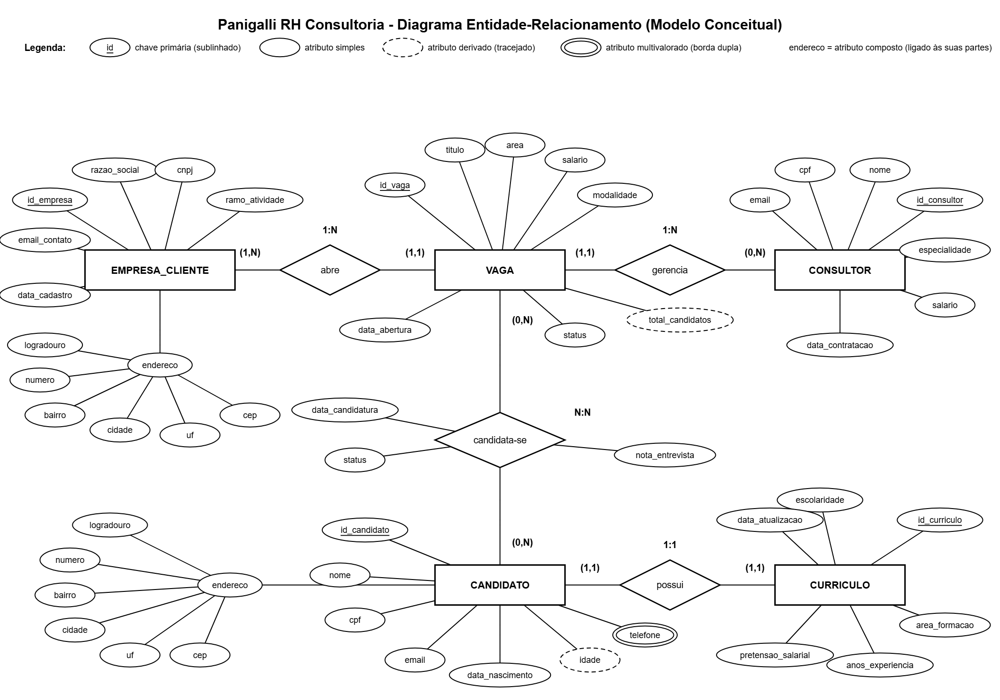

**Cardinalidades** (o par ao lado de cada entidade indica com quantas ocorrências ela participa):

- **abre (1:N):** EMPRESA_CLIENTE (1,N) e VAGA (1,1). Toda empresa cliente abre pelo menos uma vaga, e cada vaga é de uma só empresa.
- **gerencia (1:N):** CONSULTOR (0,N) e VAGA (1,1). Um consultor recém-contratado pode ainda não ter vagas; cada vaga tem obrigatoriamente um consultor.
- **candidata-se (N:N):** VAGA (0,N) e CANDIDATO (0,N). Uma vaga recém-aberta pode ainda não ter candidatos, e um candidato pode estar no banco de talentos sem ter se candidatado.
- **possui (1:1):** CANDIDATO (1,1) e CURRICULO (1,1).

---

## 3. Modelagem Lógica

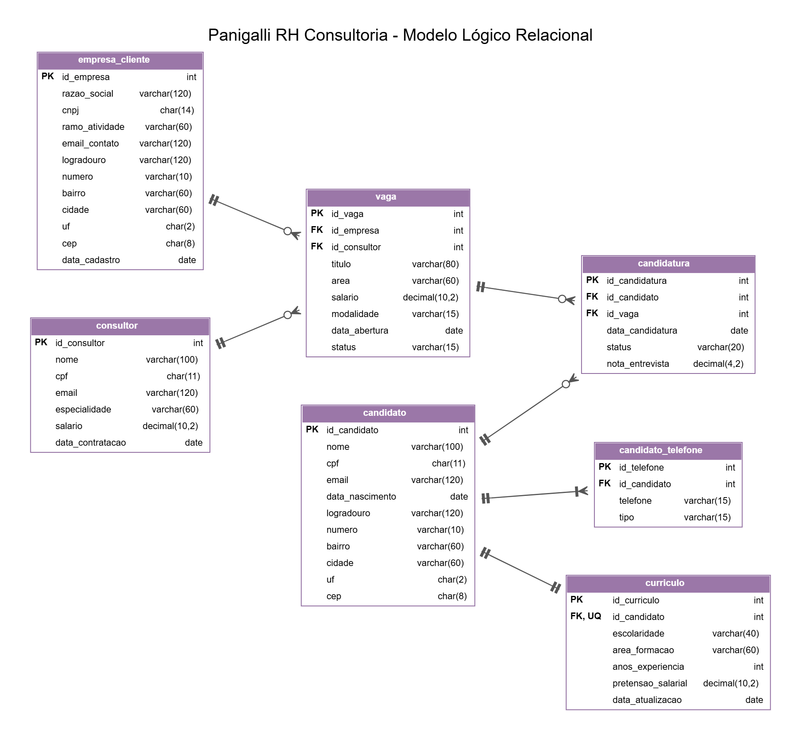

Transformações feitas do DER para o modelo relacional:

- **Atributo composto `endereco`**: virou colunas separadas (logradouro, numero, bairro, cidade, uf, cep) nas tabelas `empresa_cliente` e `candidato`.
- **Atributo multivalorado `telefone`**: virou a tabela `candidato_telefone`, com uma linha por telefone e FK para `candidato`.
- **Atributos derivados `idade` e `total_candidatos`**: não são gravados em tabela (ficariam desatualizados). São calculados nas views `vw_candidato_idade` e `vw_vaga_resumo`.
- **1:N (abre e gerencia)**: a chave do lado 1 vai como FK para o lado N, por isso `vaga` tem `id_empresa` e `id_consultor`.
- **N:N (candidata-se)**: virou a tabela associativa `candidatura`, com as FKs `id_candidato` e `id_vaga` e os atributos do relacionamento.
- **1:1 (possui)**: a FK `id_candidato` fica em `curriculo` com restrição `UNIQUE`, o que impede um candidato de ter dois currículos.

| Tabela | PK | FK | Relaciona com |
|---|---|---|---|
| empresa_cliente | id_empresa | – | vaga (1:N) |
| consultor | id_consultor | – | vaga (1:N) |
| vaga | id_vaga | id_empresa, id_consultor | empresa_cliente, consultor, candidatura |
| candidato | id_candidato | – | candidatura, candidato_telefone, curriculo |
| candidato_telefone | id_telefone | id_candidato | candidato (N:1) |
| curriculo | id_curriculo | id_candidato (UNIQUE) | candidato (1:1) |
| candidatura | id_candidatura | id_candidato, id_vaga | candidato e vaga (N:N) |

O mesmo modelo está em `diagramas/modelo_logico.dbml`, que pode ser colado em [dbdiagram.io](https://dbdiagram.io/d) para visualizar e editar.

---

## 4. Modelagem Física

O banco foi implementado no **Supabase** (PostgreSQL) com o script [`sql/01_criacao_tabelas.sql`](sql/01_criacao_tabelas.sql), executado no SQL Editor.

Decisões de implementação:

- Chaves primárias `INT GENERATED BY DEFAULT AS IDENTITY` (numeração automática).
- `NOT NULL` nos campos obrigatórios e `UNIQUE` em cpf, cnpj e e-mail.
- `CHECK` para validar valores: salário positivo, nota entre 0 e 10, listas fechadas de status, modalidade e tipo de telefone.
- `UNIQUE (id_candidato, id_vaga)` em `candidatura`, para impedir candidatura repetida.
- **Integridade referencial:**
  - `ON DELETE RESTRICT` em `vaga → empresa_cliente` e `vaga → consultor`: não dá para apagar uma empresa ou um consultor que ainda tem vagas.
  - `ON DELETE CASCADE` nas tabelas dependentes do candidato (telefone, currículo e candidatura) e em `candidatura → vaga`: ao excluir um candidato (por exemplo, a pedido dele, pela LGPD), os dados ligados a ele também são removidos.

Execução do script de criação:

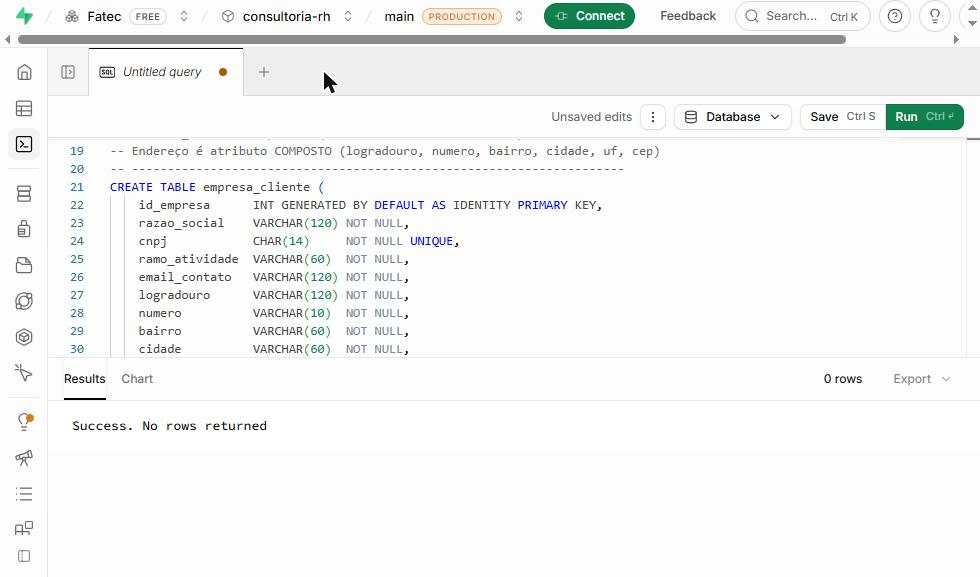

Tabelas criadas no Table Editor:

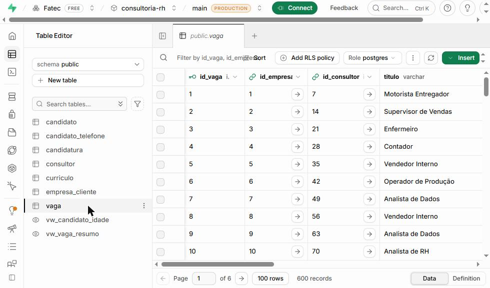

Estrutura e relacionamentos no Schema Visualizer:

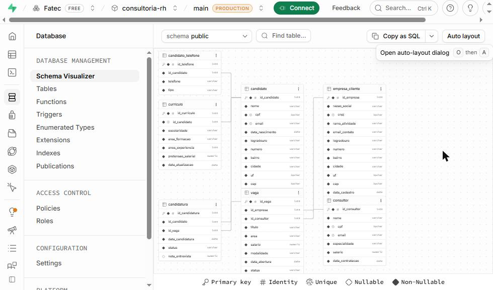

---

## 5. Dados

O script [`sql/02_insercao_dados.sql`](sql/02_insercao_dados.sql) popula o banco usando `generate_series` combinado com listas de nomes, sobrenomes, cidades, cargos, áreas etc. A função `HASHTEXT()` embaralha as escolhas de forma fixa, então rodar o script de novo gera exatamente os mesmos dados.

| Tabela | Registros |
|---|---|
| empresa_cliente | 500 |
| consultor | 500 |
| candidato | 1.000 |
| candidato_telefone | 1.700 |
| curriculo | 1.000 |
| vaga | 600 |
| candidatura | 2.000 |

Os dados respeitam as regras de negócio: todo candidato tem currículo e celular; cada candidato se candidata a 2 vagas diferentes; toda vaga recebe candidatos; a candidatura é sempre posterior à abertura da vaga; vagas preenchidas têm exatamente 1 aprovado (o de maior nota); candidatos ainda *Inscritos* não têm nota; empresas e consultores são cadastrados antes das vagas que abrem ou gerenciam.

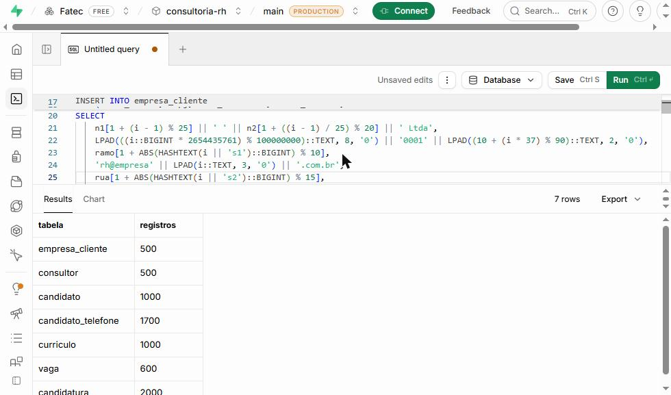

---

## 6. CRUD

Script: [`sql/03_crud.sql`](sql/03_crud.sql). O exemplo simula o ciclo de uma candidata no sistema.

**CREATE (INSERT):** cadastro da candidata Letícia, do currículo, do telefone e de uma candidatura para a vaga 5.

```sql
INSERT INTO candidato (nome, cpf, email, data_nascimento,
                       logradouro, numero, bairro, cidade, uf, cep)
VALUES ('Letícia Moraes Prado', '98765432100', 'leticia.prado@email.com', '2004-03-15',
        'Rua das Palmeiras', '250', 'Centro', 'São Paulo', 'SP', '01001000')
RETURNING *;
```

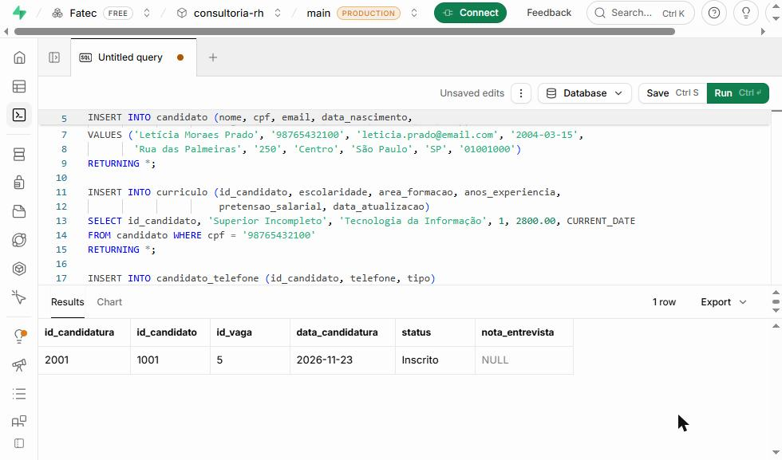

**READ (SELECT):** consulta da candidata com currículo e telefone (JOIN).

```sql
SELECT c.id_candidato, c.nome, c.email, c.cidade, c.uf,
       cv.escolaridade, cv.area_formacao, cv.pretensao_salarial,
       t.telefone, t.tipo
FROM candidato c
JOIN curriculo cv          ON cv.id_candidato = c.id_candidato
JOIN candidato_telefone t  ON t.id_candidato  = c.id_candidato
WHERE c.cpf = '98765432100';
```

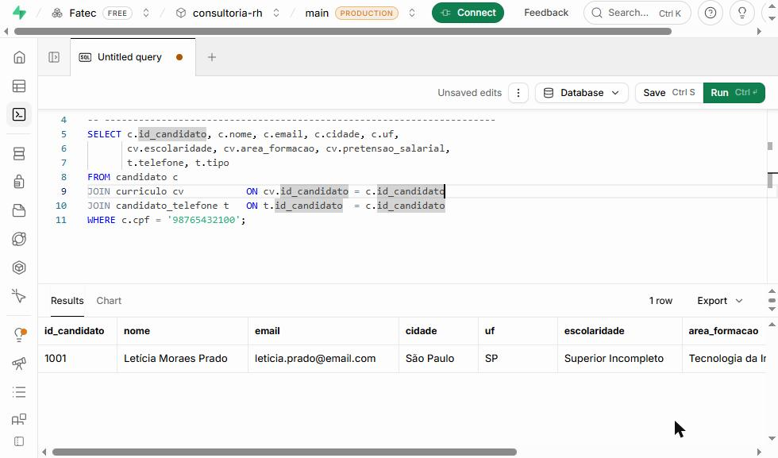

**UPDATE:** a candidata foi chamada para entrevista (status e nota) e atualizou a pretensão salarial.

```sql
UPDATE candidatura
SET status = 'Entrevista', nota_entrevista = 8.50
WHERE id_candidato = (SELECT id_candidato FROM candidato WHERE cpf = '98765432100')
  AND id_vaga = 5
RETURNING *;
```

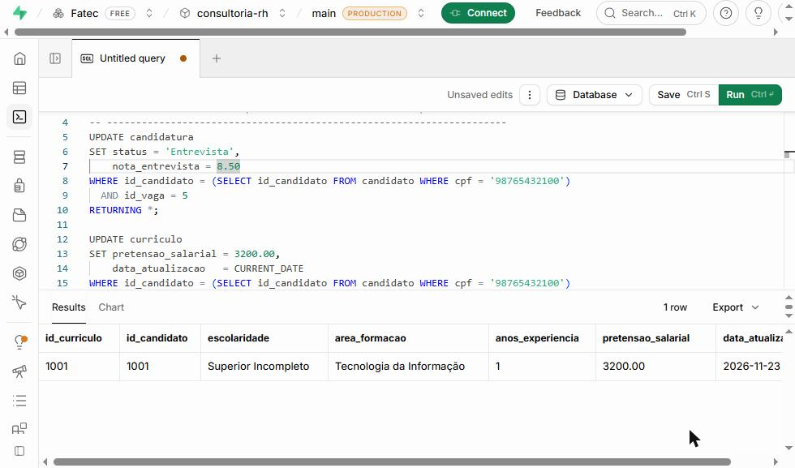

**DELETE:** a candidata pediu a exclusão dos seus dados. Por causa do `ON DELETE CASCADE`, currículo, telefone e candidatura dela são apagados junto.

```sql
DELETE FROM candidato
WHERE cpf = '98765432100'
RETURNING id_candidato, nome;
```

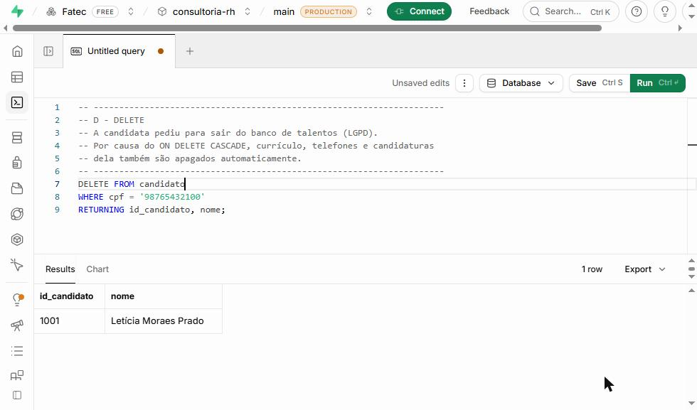

---

## 7. Relatórios

Script completo: [`sql/04_relatorios.sql`](sql/04_relatorios.sql). Todas as consultas usam **SELECT, WHERE, ORDER BY e JOIN**.

**Relatório 1 – Vagas abertas com empresa e consultor responsável.** Quais vagas ainda estão abertas, de qual empresa e quem cuida delas? (as de maior salário primeiro)

```sql
SELECT v.id_vaga, v.titulo, v.salario, v.modalidade,
       e.razao_social AS empresa, e.cidade,
       co.nome        AS consultor_responsavel
FROM vaga v
JOIN empresa_cliente e ON e.id_empresa   = v.id_empresa
JOIN consultor co      ON co.id_consultor = v.id_consultor
WHERE v.status = 'Aberta'
ORDER BY v.salario DESC;
```

**Relatório 2 – Candidatos aprovados.** Quem foi aprovado, em qual vaga e em qual empresa?

```sql
SELECT ca.nome AS candidato, v.titulo AS vaga, e.razao_social AS empresa,
       cd.nota_entrevista, cd.data_candidatura
FROM candidatura cd
JOIN candidato ca      ON ca.id_candidato = cd.id_candidato
JOIN vaga v            ON v.id_vaga       = cd.id_vaga
JOIN empresa_cliente e ON e.id_empresa    = v.id_empresa
WHERE cd.status = 'Aprovado'
ORDER BY cd.nota_entrevista DESC, ca.nome;
```

**Relatório 3 – Quantidade de candidatos por vaga (atributo derivado).** Quais vagas em andamento receberam mais candidatos?

```sql
SELECT v.id_vaga, v.titulo, e.razao_social AS empresa,
       COUNT(cd.id_candidatura) AS total_candidatos
FROM vaga v
JOIN empresa_cliente e ON e.id_empresa = v.id_empresa
JOIN candidatura cd    ON cd.id_vaga   = v.id_vaga
WHERE v.status IN ('Aberta', 'Em seleção')
GROUP BY v.id_vaga, v.titulo, e.razao_social
ORDER BY total_candidatos DESC, v.id_vaga;
```

**Relatório 4 – Desempenho dos consultores.** Quais consultores mais preencheram vagas?

```sql
SELECT co.nome AS consultor, co.especialidade,
       COUNT(v.id_vaga) AS vagas_preenchidas
FROM consultor co
JOIN vaga v ON v.id_consultor = co.id_consultor
WHERE v.status = 'Preenchida'
GROUP BY co.id_consultor, co.nome, co.especialidade
ORDER BY vagas_preenchidas DESC, co.nome;
```

**Relatório 5 – Contatos dos candidatos mais qualificados (multivalorado).** Telefones dos candidatos com Pós-graduação ou Mestrado.

```sql
SELECT ca.nome, cv.escolaridade, cv.area_formacao, t.tipo, t.telefone
FROM candidato ca
JOIN curriculo cv          ON cv.id_candidato = ca.id_candidato
JOIN candidato_telefone t  ON t.id_candidato  = ca.id_candidato
WHERE cv.escolaridade IN ('Pós-graduação', 'Mestrado')
ORDER BY ca.nome, t.tipo;
```

**Relatório 6 – Pretensão salarial compatível com a vaga.** Em quais candidaturas em andamento o salário oferecido atende à pretensão do candidato?

```sql
SELECT ca.nome AS candidato, cv.pretensao_salarial,
       v.titulo AS vaga, v.salario AS salario_vaga, cd.status
FROM candidatura cd
JOIN candidato ca ON ca.id_candidato = cd.id_candidato
JOIN curriculo cv ON cv.id_candidato = ca.id_candidato
JOIN vaga v       ON v.id_vaga       = cd.id_vaga
WHERE cv.pretensao_salarial <= v.salario
  AND v.status IN ('Aberta', 'Em seleção')
ORDER BY (v.salario - cv.pretensao_salarial) DESC;
```

**Relatório 7 – Média salarial das vagas remotas por área.** Quanto pagam, em média, as vagas remotas de cada área?

```sql
SELECT v.area, v.modalidade,
       COUNT(*)                 AS qtd_vagas,
       ROUND(AVG(v.salario), 2) AS media_salarial
FROM vaga v
JOIN empresa_cliente e ON e.id_empresa = v.id_empresa
WHERE v.modalidade = 'Remoto'
GROUP BY v.area, v.modalidade
ORDER BY media_salarial DESC;
```

**Relatório 8 – Candidatos jovens em entrevista (atributo derivado idade).** Quem tem de 22 a 30 anos e está em fase de entrevista, e para qual vaga?

```sql
SELECT vi.nome, vi.idade, v.titulo AS vaga, cd.nota_entrevista
FROM vw_candidato_idade vi
JOIN candidatura cd ON cd.id_candidato = vi.id_candidato
JOIN vaga v         ON v.id_vaga       = cd.id_vaga
WHERE cd.status = 'Entrevista'
  AND vi.idade BETWEEN 22 AND 30
ORDER BY vi.idade, cd.nota_entrevista DESC;
```

**Relatório 9 – Empresas de SP que mais demandam a consultoria.**

```sql
SELECT e.razao_social, e.cidade, e.ramo_atividade,
       COUNT(v.id_vaga) AS total_vagas,
       SUM(CASE WHEN v.status = 'Preenchida' THEN 1 ELSE 0 END) AS vagas_preenchidas
FROM empresa_cliente e
JOIN vaga v ON v.id_empresa = e.id_empresa
WHERE e.uf = 'SP'
GROUP BY e.id_empresa, e.razao_social, e.cidade, e.ramo_atividade
ORDER BY total_vagas DESC, e.razao_social;
```

**Relatório 10 – Taxa de aprovação por área de formação.** Candidatos de quais formações são mais aprovados?

```sql
SELECT cv.area_formacao,
       COUNT(*) AS candidaturas,
       SUM(CASE WHEN cd.status = 'Aprovado' THEN 1 ELSE 0 END) AS aprovacoes,
       ROUND(100.0 * SUM(CASE WHEN cd.status = 'Aprovado' THEN 1 ELSE 0 END) / COUNT(*), 2) AS taxa_aprovacao
FROM candidatura cd
JOIN curriculo cv ON cv.id_candidato = cd.id_candidato
JOIN vaga v       ON v.id_vaga       = cd.id_vaga
WHERE v.status <> 'Cancelada'
GROUP BY cv.area_formacao
ORDER BY taxa_aprovacao DESC;
```

Exemplo de execução no Supabase (Relatório 1):

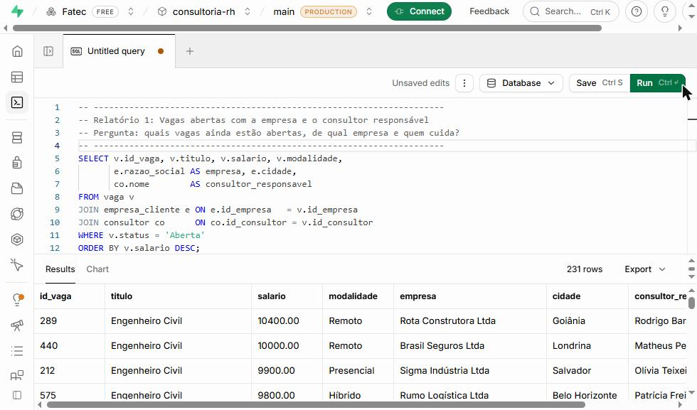
